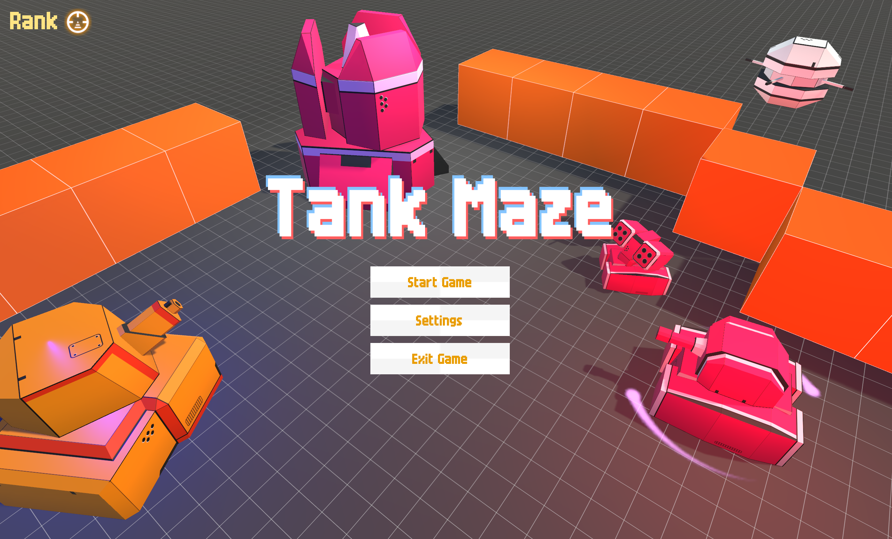
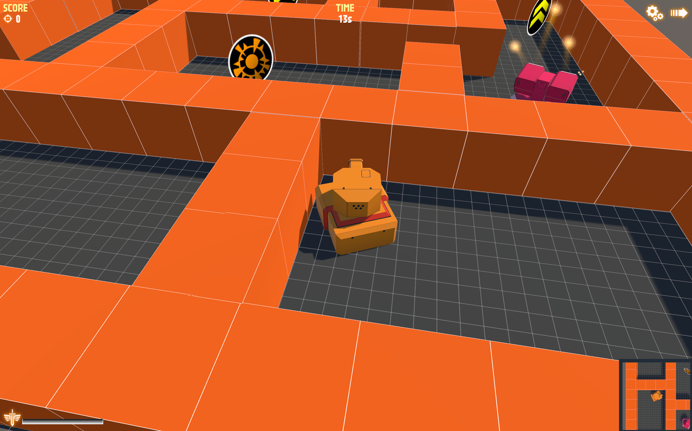
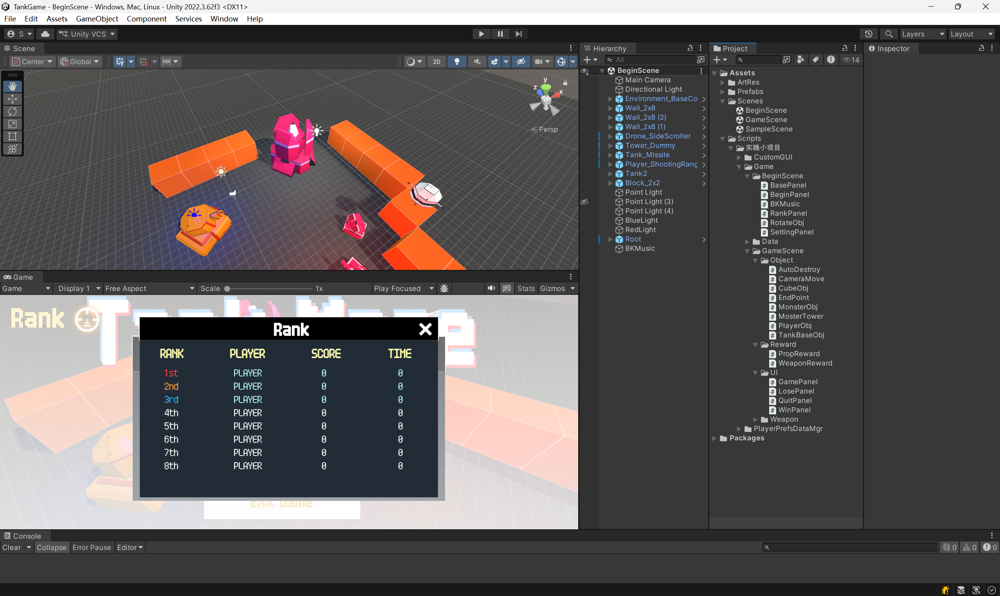
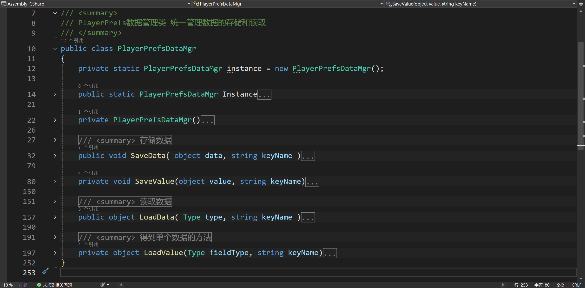

# TankMaze

### Unity / C# 坦克小游戏开发实践

## 项目简介

TankMaze 是一款基于 Unity 引擎与 C# 语言开发的坦克小游戏

项目以游戏开发教程为学习基础，通过实际制作，学习 Unity 引擎的基本工作流程及游戏功能的程序实现。

在完成基础游戏项目的同时，我进一步开展了自主编程实践，包括独立复刻游戏存档系统和自定义 UI 系统，加深对面向对象程序设计、数据管理及模块化开发的理解。

## 技术栈

- 游戏引擎：Unity
- 编程语言：C#
- 开发工具：Visual Studio
- 技术知识：面向对象编程、单例模式、反射、数据持久化、GUI 控件开发

## 项目实践内容

**1. 坦克小游戏开发**

基于 Unity 完成可正常运行和游玩的坦克小游戏，学习游戏对象管理、玩家控制、碰撞检测及游戏界面等基础功能的实现。

**2. 存档系统独立复刻**

使用 C# 独立复刻数据管理功能，练习单例模式、数据保存与读取、不同数据类型的处理，以及反射机制在程序设计中的应用。

**3. 自定义 UI 系统独立复刻**

通过 C# 编程实践，实现 UI 控件的定位、布局与样式管理，加深对界面交互逻辑和程序模块封装的理解。

## 项目展示

### 1. 游戏主界面

### 2. 游戏运行画面

### 3. Unity 项目开发

### 4. 数据持久化与存档系统

## 学习总结

通过该项目，我逐渐从单纯理解编程语法和 Unity 组件，转向思考如何将不同功能组织为完整的游戏系统。

在独立复刻功能模块的过程中，我进一步认识到了程序结构设计和代码复用的重要性，也发现自己在复杂系统架构与独立开发能力方面仍有提升空间。

未来希望继续深入学习软件开发、实时交互技术与数字媒体相关知识，通过更多项目实践提高独立分析和解决问题的能力。

